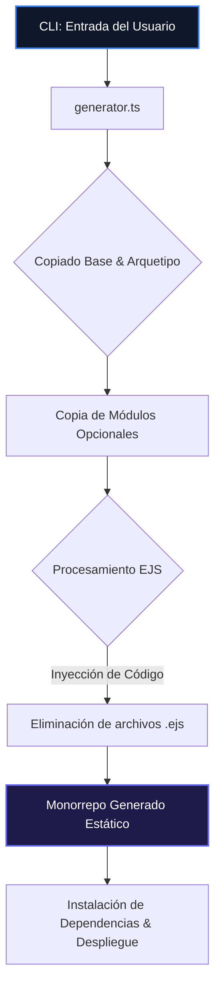
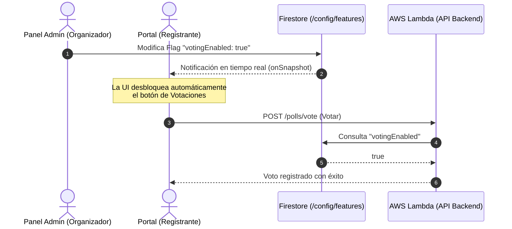

# Reporte Arquitectonico: Evaluacion de Feature Flags en `unbj-echo`

Este documento analiza la arquitectura actual del generador de plataformas de registro **unbj-echo** y evalua la viabilidad, ventajas, inconvenientes y diseno tecnico de implementar un sistema de **Feature Flags** (Banderas de Caracteristicas).

---

## 1. Resumen Ejecutivo

Actualmente, `unbj-echo` opera como un **generador de codigo a nivel de compilacion (build-time)** utilizando plantillas EJS para inyectar o remover dinamicamente modulos y arquetipos antes del despliegue.

> [!IMPORTANT]
> **Conclusión del análisis:** **Sí, la implementación de Feature Flags beneficiaría enormemente al proyecto**, pero a dos niveles diferentes:
> 1. **Feature Flags Estáticas (Build-time / Config-time):** Para simplificar el CLI del generador, eliminar las complejas plantillas EJS y habilitar el tipado estático completo de TypeScript en el repositorio de plantillas.
> 2. **Feature Flags Dinámicas (Runtime via Firestore):** Para proporcionar flexibilidad operativa a los organizadores del evento en tiempo real (por ejemplo, abrir/cerrar votaciones, talleres, habitaciones, o cambiar métodos de pago sin redesplegar).

---

## 2. Análisis de la Arquitectura Actual (Basada en EJS)

El flujo de generación actual del CLI se estructura de la siguiente manera:



### Limitaciones de la Arquitectura EJS Actual
* **Complejidad de Mantenimiento:** Archivos como [ActionBlock.tsx.ejs](file:///Users/raulcanul/Documents/Dev/platform-register/templates/base/apps/portal/src/components/portal/ActionBlock.tsx.ejs) y [RegistroFlow.tsx.ejs](file:///Users/raulcanul/Documents/Dev/platform-register/templates/base/apps/portal/src/components/registro/RegistroFlow.tsx.ejs) están plagados de directivas EJS (`<% if ... %>`). Esto impide el formateo automático (Prettier), dificulta el análisis estático (ESLint) y deshabilita el autocompletado de TypeScript en los editores de código.
* **Fragilidad de Compilación:** Cualquier error de sintaxis dentro de un bloque condicional de EJS solo se detecta *después* de generar el proyecto y correr la verificación de tipos (`tsc`). Probar todas las permutaciones posibles (3 arquetipos $\times$ 16 combinaciones de módulos $\times$ 2 idiomas = 96 escenarios) es computacionalmente lento y complejo de automatizar.
* **Rigidez Post-Despliegue:** Una vez desplegado el proyecto (por ejemplo, a AWS Lambda y Firebase), si el organizador del evento requiere activar un módulo (ej. Votaciones) que omitió al inicio, se ve obligado a generar y desplegar un nuevo proyecto desde cero, lo que implica un alto riesgo operativo y de migración de datos.

---

## 3. Propuesta: Modelos de Feature Flags

Podemos reestructurar el sistema utilizando dos enfoques complementarios:

### A. Feature Flags Estáticas (CLI a nivel de Código)
En lugar de recortar código físicamente con EJS, el generador copia **todo el monorrepo con todos los módulos y arquetipos disponibles**. La habilitación de las características se controla mediante un archivo de configuración estática generado por el CLI (ej. `features.config.json` o variables de entorno `.env` en Next.js).

* **En la UI de Next.js:**
  ```tsx
  import { config } from '@/config'

  export function Portal() {
    return (
      <div>
        <CommonFeatures />
        {config.features.tshirt && <ShirtSizeSelector />}
        {config.features.voting && <VotingPanel />}
      </div>
    )
  }
  ```

### B. Feature Flags Dinámicas (Runtime via Firestore)
Aprovechando que la base de datos target es **Firebase Firestore**, podemos centralizar la configuración de las banderas de características en un documento único (ej. `/config/features`). Los clientes Next.js se suscriben a este documento en tiempo real y el backend (AWS Lambda) valida las peticiones contra este estado.



---

## 4. Comparativa Técnica de Enfoques

| Criterio | Arquitectura EJS (Actual) | Feature Flags Estáticas (Config-time) | Feature Flags Dinámicas (Runtime) |
| :--- | :--- | :--- | :--- |
| **Mantenimiento del Código** | 🔴 Muy Complejo (Plantillas EJS sin formateo ni linting) | 🟢 Excelente (TypeScript puro en todos los archivos) | 🟢 Excelente (TypeScript puro en todos los archivos) |
| **Seguridad de Tipos (Type-Safety)** | 🟡 Parcial (Solo post-generación) | 🟢 Total (Se verifica en el repositorio base) | 🟢 Total (Interfaces y validaciones bien definidas) |
| **Flexibilidad de Operación** | 🔴 Nula (Requiere redespliegue de código) | 🔴 Nula (Requiere redespliegue de código) | 🟢 Inmediata (Toggles en vivo sin redesplegar) |
| **Tamaño del Bundle (JS)** | 🟢 Mínimo (Solo el código seleccionado) | 🟡 Medio (Mitigado con *Dynamic Imports* de Next.js) | 🟡 Medio (Mitigado con *Dynamic Imports* de Next.js) |
| **Complejidad del Generador** | 🔴 Alta (Inyección de serverless, package.json, i18n) | 🟢 Baja (Solo escribe un archivo JSON/ENV base) | 🟢 Baja (Escribe la configuración inicial en Firestore) |
| **Rendimiento** | 🟢 Alto (Carga estática instantánea) | 🟢 Alto (Carga estática instantánea) | 🟡 Dependiente (Requiere una consulta rápida a BD) |

---

## 5. Casos de Uso Concretos en Plataformas de Registro

A continuación se detallan escenarios reales donde la implementación de Feature Flags dinámicas resolvería problemas operativos comunes de eventos reales:

### Caso 1: Flujo de Votación Coordinada (Módulo `voting`)
* **Problema con EJS:** El portal expone el panel de votación desde el día uno si el módulo se inyecta. Los usuarios pueden intentar interactuar con él antes de tiempo.
* **Solución con Flags:** El panel de votación está oculto y bloqueado en la API. El moderador del evento activa la flag `active_poll_id` en tiempo real desde el Panel Admin únicamente durante los 5 minutos que dure la votación plenaria.

### Caso 2: Control de Capacidad y Fases (Módulo `workshops` / `rooms`)
* **Problema con EJS:** Una vez compilado el arquetipo, el comportamiento de las inscripciones es fijo.
* **Solución con Flags:** 
  * Flag `workshops_selection_enabled`: Permite abrir la selección de talleres semanas después de haber pagado la entrada estándar, notificando por correo a los ya registrados.
  * Flag `rooms_assignment_enabled`: Habilita la autogestión de cuartos de hotel solo cuando la asignación logística general esté lista.

### Caso 3: Cierre de Registro y Modos de Emergencia (Kill Switches)
* **Problema con EJS:** Si el evento se llena, se debe desplegar código que modifique la página de inicio para remover el formulario.
* **Solución con Flags:** La flag `registration_open: false` redirige instantáneamente a los nuevos visitantes a una lista de espera o muestra un banner de "Cupo Completo".

---

## 6. Diseño Técnico Propuesto (Ejemplos de Código)

### A. Contexto de React para Feature Flags en Next.js
Podemos envolver el portal en un proveedor que lea en tiempo real desde Firestore:

```tsx
// apps/portal/src/context/FeatureFlagsContext.tsx
import React, { createContext, useContext, useEffect, useState } from 'react'
import { doc, onSnapshot } from 'firebase/firestore'
import { db } from '@/lib/firebase'

interface Flags {
  registrationOpen: boolean
  votingEnabled: boolean
  workshopsEnabled: boolean
  roomsEnabled: boolean
  stripePaymentEnabled: boolean
  oxxoPaymentEnabled: boolean
}

const defaultFlags: Flags = {
  registrationOpen: true,
  votingEnabled: false,
  workshopsEnabled: false,
  roomsEnabled: false,
  stripePaymentEnabled: true,
  oxxoPaymentEnabled: true,
}

const FlagsContext = createContext<Flags>(defaultFlags)

export function FeatureFlagsProvider({ children }: { children: React.ReactNode }) {
  const [flags, setFlags] = useState<Flags>(defaultFlags)

  useEffect(() => {
    // Suscribirse a la configuración del evento en Firestore
    const unsub = onSnapshot(doc(db, 'config', 'features'), (docSnap) => {
      if (docSnap.exists()) {
        setFlags(docSnap.data() as Flags)
      }
    })
    return () => unsub()
  }, [])

  return (
    <FlagsContext.Provider value={flags}>
      {children}
    </FlagsContext.Provider>
  )
}

export const useFeatureFlags = () => useContext(FlagsContext)
```

### B. Uso de las Flags en la Interfaz de Usuario
Rediseño simplificado del componente `ActionBlock` sin directivas EJS:

```tsx
// apps/portal/src/components/portal/ActionBlock.tsx
'use client'

import React from 'react'
import dynamic from 'next/dynamic'
import { useFeatureFlags } from '@/context/FeatureFlagsContext'
import type { Registration } from '@plenarias/shared'

// Carga perezosa (Dynamic Imports) para optimizar bundle sizes
const ShirtSizeSelector = dynamic(() => import('../shirt-size/ShirtSizeSelector').then(mod => mod.ShirtSizeSelector))
const WorkshopsBlock = dynamic(() => import('../workshops/WorkshopsBlock'))
const RoomsBlock = dynamic(() => import('../rooms/RoomsBlock'))
const VotingBlock = dynamic(() => import('../voting/VotingBlock'))

export function ActionBlock({ registration }: { registration: Registration }) {
  const flags = useFeatureFlags()

  return (
    <div className="flex flex-col gap-6">
      {/* Componentes base del flujo de registro aprobado */}
      <ApprovedTicketCard registration={registration} />

      {/* Inyección condicionada mediante Feature Flags en Runtime */}
      {flags.tshirtEnabled && (
        <ShirtSizeSelector token={registration.token} />
      )}

      {flags.workshopsEnabled && (
        <WorkshopsBlock registration={registration} />
      )}

      {flags.roomsEnabled && (
        <RoomsBlock registration={registration} />
      )}

      {flags.votingEnabled && (
        <VotingBlock registration={registration} />
      )}
    </div>
  )
}
```

### C. Guardias en Endpoints de AWS Lambda (Backend API)
Evita el procesamiento de peticiones en módulos deshabilitados:

```typescript
// packages/api/src/handlers/polls/vote.ts
import { db } from '../../lib/firebase'
import type { APIGatewayProxyEvent, APIGatewayProxyResult } from 'aws-lambda'

export async function handler(event: APIGatewayProxyEvent): Promise<APIGatewayProxyResult> {
  // 1. Validar estado de la Feature Flag
  const configDoc = await db.collection('config').doc('features').get()
  const flags = configDoc.data()

  if (!flags || !flags.votingEnabled) {
    return {
      statusCode: 403,
      body: JSON.stringify({ error: 'La funcionalidad de votación está desactivada temporalmente.' }),
    }
  }

  // 2. Ejecutar lógica normal de votación
  // ...
}
```

---

## 7. Plan de Migración / Hoja de Ruta Recomendada

Para transicionar de la generación estática basada en EJS a un esquema robusto de Feature Flags sin romper la estabilidad actual, se sugiere la siguiente ruta de 4 pasos:

### Paso 1: Estandarización de Plantillas (Eliminar EJS de la UI)
* Convertir todos los archivos `.tsx.ejs` a archivos `.tsx` convencionales en las carpetas base del generador.
* Implementar un archivo local `features.config.json` en las plantillas.
* Sustituir los condicionales `<% if (modules.includes('x')) %>` por importaciones dinámicas (`dynamic()`) y expresiones booleanas (`config.features.x && ...`).
* **Resultado:** El código base compila y puede ser verificado estáticamente con `tsc` directamente dentro de la carpeta `templates/` sin necesidad de generar permutaciones de prueba.

### Paso 2: Adaptar el CLI del Generador
* Modificar [generator.ts](file:///Users/raulcanul/Documents/Dev/platform-register/src/utils/generator.ts) para que copie la totalidad del monorrepo unificado.
* En lugar de procesar condicionales EJS en cada archivo, la función de generación escribirá el archivo local `features.config.json` (o `.env`) con los booleanos correspondientes a la selección del usuario en la CLI.
* **Resultado:** Se reduce el código del generador en un 60%, eliminando la manipulación de endpoints y dependencias. Las pruebas en `test-generator.mjs` se vuelven instantáneas.

### Paso 3: Integración de Flags en Base de Datos (Firestore)
* Crear la colección `/config` en la base de datos Firestore y guardar un documento `features` que centralice los estados dinámicos de las banderas.
* Añadir el `FeatureFlagsProvider` al portal web y al panel administrativo.
* Implementar las interfaces del Panel de Administración para que los organizadores del evento puedan alterar los valores de las banderas en tiempo real con un interruptor (`switch`) en la interfaz gráfica.

### Paso 4: Pruebas y Limpieza
* Ejecutar la matriz de pruebas (`test-generator.mjs`) para garantizar que la compilación es exitosa.
* Eliminar el código huérfano de inyección que ya no se utiliza en el CLI.

---

## 8. Recomendaciones Finales

> [!TIP]
> **Recomendación:** Se sugiere realizar una **migración híbrida**:
> 
> * **Mantener el arquetipo en build-time (EJS):** Dado que los arquetipos (`standard`, `roles`, `plenarias`) representan arquitecturas de base de datos y flujos de negocio fundamentalmente incompatibles (por ejemplo, `plenarias` requiere relaciones complejas de iglesias y validaciones de cartas que no tienen sentido en un registro `standard`), es correcto que se sigan dividiendo en directorios de plantillas separados.
> * **Migrar los módulos opcionales a Feature Flags:** Las características adicionales (`tshirt`, `workshops`, `rooms`, `voting`) son "rompecabezas" independientes que pueden coexistir en cualquier base de código. Habilitarlos mediante Feature Flags elimina la fragilidad y eleva significativamente el valor y adaptabilidad de la plataforma para los organizadores de eventos en el mundo real.

---
<!-- GOAL_COMPLETE -->
