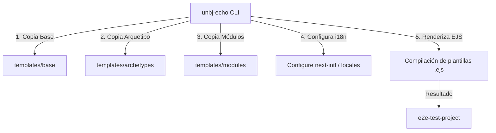

# Arquitectura y Funcionamiento del Sistema

Este documento proporciona una guía detallada sobre la arquitectura del generador, el ciclo de vida de las plantillas y el funcionamiento interno del monorepo generado, incluyendo flujos clave de negocio y configuración del sistema.

---

## 1. Arquitectura del Generador (`unbj-echo`)

El generador está estructurado para permitir la creación ágil de monorrepos de registro basados en arquetipos de flujo e inyección modular de características ("puzzle pieces").



### Componentes del Generador
1. **[index.ts](file:///Users/raulcanul/Documents/Dev/platform-register/src/index.ts):** Punto de entrada del CLI. Maneja los argumentos no interactivos mediante Commander.js y el flujo visual interactivo con `@clack/prompts`.
2. **[generator.ts](file:///Users/raulcanul/Documents/Dev/platform-register/src/utils/generator.ts):** Orquestador de la generación. Copia la base común, aplica el arquetipo seleccionado, inyecta los módulos opcionales, configura el middleware de `next-intl` (si se selecciona multi-idioma) y compila todas las plantillas `.ejs` de forma recursiva.
3. **[split-monorepo.mjs](file:///Users/raulcanul/Documents/Dev/platform-register/scripts/split-monorepo.mjs):** Script utilitario de desarrollo. Limpia las plantillas existentes y repobla la base y arquetipos desde el proyecto de referencia `/registro-plenarias`, ejecutando limpieza de archivos duplicados y aplicando inyecciones/correcciones dinámicas para garantizar que las plantillas resultantes sean genéricas y tipadas.

---

## 2. Estructura del Monorepo Generado

El proyecto resultante es un monorrepo gestionado mediante **PNPM Workspaces**, compuesto por las siguientes aplicaciones y paquetes compartidos:

```
test-generation-build/
├── apps/
│   ├── admin/             # Panel Administrativo (Next.js Dashboard)
│   └── portal/            # Portal del Registrante (Next.js Portal & Form)
├── packages/
│   ├── api/               # API Lambda Serverless (AWS, Node.js, TS)
│   ├── emails/            # Plantillas de correo (React Email)
│   └── shared/            # Modelos, tipos TS y constantes compartidas
├── package.json           # Definición de workspaces de pnpm
└── pnpm-workspace.yaml    # Configuración de workspaces de pnpm
```

### Detalle de Proyectos en el Workspace
* **`apps/portal`:** Desarrollado con Next.js (App Router), Tailwind CSS y `next-intl` para i18n. Alberga el flujo de registro y las interfaces de usuario para módulos adicionales (talleres, habitaciones, etc.).
* **`apps/admin`:** Panel administrativo basado en Next.js. Permite buscar registros, aprobar pagos offline/en efectivo, validar cartas de acreditación y gestionar votaciones en vivo en pantallas/proyectores.
* **`packages/api`:** Backend serverless que se despliega en AWS Lambda usando Serverless Framework. Proporciona endpoints rápidos de TypeScript, maneja transacciones atómicas de Firestore, interactúa con Stripe para pagos y Resend para correos electrónicos.
* **`packages/shared`:** Define la interfaz unificada de `Registration` y constantes globales (como códigos de estado, nombres de métodos de pago, etc.), garantizando que tanto la API como las dos aplicaciones Next.js compartan exactamente las mismas reglas de tipos TS.

---

## 3. Flujos de Registro por Arquetipo

El sistema adapta el flujo inicial de registro según el arquetipo de evento seleccionado:

| Flujo / Paso | Arquetipo: `standard` | Arquetipo: `roles` | Arquetipo: `plenarias` (CNBM) |
| :--- | :--- | :--- | :--- |
| **Paso 1** | Datos personales básicos | Datos personales básicos | Búsqueda y selección de Iglesia / Convención |
| **Paso 2** | Flujo de Pago directo | Selección de Tier (VIP, General, Estudiante) | Carga de Carta de Acreditación (opcional si es fraternal) |
| **Paso 3** | Confirmación y Pase QR | Flujo de Pago según el Tier elegido | Datos personales y confirmación |
| **Aprobación** | Instantánea al pagar | Instantánea al pagar | Manual por Admin (Carta + Pago) |

---

## 4. Funcionamiento de Módulos Adicionales (Puzzle Pieces)

Los módulos se inyectan dinámicamente en el monorrepo copiando sus respectivas carpetas y agregando los endpoints y dependencias correspondientes de forma automatizada:

### A. Tallas de Playeras (`tshirt`)
Módulo sencillo de colección de datos. Permite al usuario seleccionar su talla del kit de bienvenida una vez que su registro ha sido completamente aprobado.
* **Backend:** `/users/shirt-size/status` y `/users/shirt-size/select`
* **Firestore:** Almacena la talla en el campo `tshirtSize` del documento de registro.

### B. Selección de Talleres (`workshops`)
Permite a los asistentes inscribirse a talleres específicos del evento con cupos limitados.
* **Atomicidad con Transacciones:** Para evitar sobreventa de cupos bajo condiciones de carrera (múltiples usuarios inscribiéndose al mismo tiempo), el backend implementa transacciones atómicas (`db.runTransaction` de Firestore Admin SDK):
  1. Lee el estado del taller y su cupo actual.
  2. Si tiene cupo libre, incrementa `currentAssistants` en 1.
  3. Registra el taller en el perfil del usuario.
  4. Realiza el commit de forma segura; si el cupo se llena antes de confirmar la transacción de este usuario, la base de datos la rechaza de manera segura.

### C. Hospedaje y Asignación de Cuartos (`rooms`)
Permite a los asistentes auto-organizarse en habitaciones (dobles, triples o cuádruples) controlando restricciones de género y capacidad.
* **Código de Invitación:** Un usuario crea la habitación y obtiene un código único (ej. `RM-XYZ`). Sus compañeros introducen el código en sus portales para enviar una solicitud de ingreso.
* **Gestión de Invitados:** El creador del cuarto (líder) puede ver la lista de solicitudes pendientes en tiempo real y aceptarlas o rechazarlas directamente desde el portal.

### D. Votación en Tiempo Real (`voting`)
Diseñado para asambleas y plenarias deliberativas que requieren votaciones instantáneas del quórum.
* **Arquitectura Reactiva:** En lugar de usar WebSockets complejos de mantener en entornos serverless, utiliza la capacidad de sincronización nativa en tiempo real del SDK de Firebase Client mediante `onSnapshot` apuntando a `/polls/active`.
* **Seguridad:** El backend valida mediante tokens Bearer que el votante esté registrado, aprobado y que no haya emitido un voto previamente para la propuesta activa (`votedPolls`).
* **Pantalla de Proyector:** El panel admin incluye una ruta `/votaciones` diseñada para proyectores que muestra los resultados en tiempo real con gráficas reactivas a medida que los votos entran.

---

## 5. Configuración y Variables de Entorno

El proyecto generado requiere la configuración de las siguientes variables para operar:

### Aplicaciones Frontend (`apps/portal/.env.local` y `apps/admin/.env.local`)
```env
NEXT_PUBLIC_API_URL=http://localhost:3001
NEXT_PUBLIC_FIREBASE_API_KEY=tu-firebase-api-key
NEXT_PUBLIC_FIREBASE_AUTH_DOMAIN=tu-proyecto.firebaseapp.com
NEXT_PUBLIC_FIREBASE_PROJECT_ID=tu-proyecto-id
NEXT_PUBLIC_FIREBASE_STORAGE_BUCKET=tu-proyecto.appspot.com
NEXT_PUBLIC_FIREBASE_MESSAGING_SENDER_ID=tu-sender-id
NEXT_PUBLIC_FIREBASE_APP_ID=tu-app-id
```

### Backend API (`packages/api/serverless.yml` o variables de entorno locales)
```env
STRIPE_SECRET_KEY=sk_test_...
STRIPE_WEBHOOK_SECRET=whsec_...
RESEND_API_KEY=re_...
FIREBASE_SERVICE_ACCOUNT_JSON={"type":"service_account",...}
```

---

## 6. Ciclo de Vida del Desarrollo e Inyecciones

Cuando se ejecuta `node scripts/split-monorepo.mjs`, el flujo de inyección es secuencial:
1. Copia el monorrepo de referencia desde `/registro-plenarias`.
2. Convierte archivos clave en plantillas `.ejs` (como configuraciones y archivos de rutas de API).
3. Inyecta funciones compartidas (como `verifyRegistrantToken` y `db` exports) dinámicamente en los archivos de la base.
4. Aplica fallbacks de TypeScript para evitar que la falta de campos de un arquetipo rompa las vistas compartidas en el compilador.
5. Limpia archivos duplicados del arquetipo de `plenarias` asegurándose de no dejar copias estáticas antiguas que interfieran con la compilación dinámica.
