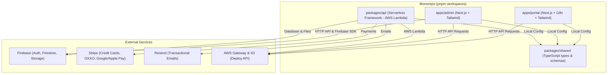

# Diseño Arquitectónico y Plan de Implementación
## Generador de Plataformas de Registro de Eventos (unbj-echo CLI)

**Versión:** 1.1  
**Fecha:** Junio 2026  
**Arquitectura Target:** Monorepo (pnpm workspaces) · Next.js · Serverless Framework (AWS Lambda) · Firebase (Firestore/Auth/Storage) · i18n (next-intl) · Tailwind CSS

---

## 1. Resumen Ejecutivo y Objetivos

El objetivo de este proyecto es generalizar el sistema de registro desarrollado para las **Plenarias de la CNBM** y transformarlo en una herramienta generadora (CLI) que permita a los desarrolladores estructurar rápidamente plataformas de registro adaptadas a las necesidades específicas de distintos eventos. 

La plataforma generada mantendrá la arquitectura del proyecto original (Serverless backend en AWS + Firebase + Next.js frontend), pero introduciendo flexibilidad mediante arquetipos de evento, soporte multi-idioma (next-intl) y inyección de **módulos funcionales tipo "rompecabezas"** que adaptan lógicas complejas de otros proyectos de manera 100% serverless.

---

## 2. Arquitectura de la Plataforma Generada

El CLI generará una estructura de **Monorepo** gestionada con `pnpm workspaces` que replica la separación clara de responsabilidades del proyecto base.



---

## 3. Arquetipos de Registro (Flujo Base)

El CLI ofrecerá elegir un "Arquetipo" durante la configuración del proyecto, el cual determinará la lógica y los campos por defecto:

| Característica | Arquetipo: Registro Estándar | Arquetipo: Registro por Roles/Entradas | Arquetipo: Plenarias CNBM (Original) |
| :--- | :--- | :--- | :--- |
| **Público Objetivo** | Congresos generales, webinarios, festivales. | Conferencias corporativas, eventos VIP/General. | Convenciones eclesiásticas de la CNBM. |
| **Flujo de Acceso** | Datos básicos $\rightarrow$ Pago (opcional) $\rightarrow$ Hoja con QR | Datos básicos $\rightarrow$ Selección de Entrada $\rightarrow$ Pago $\rightarrow$ Hoja con QR | Datos básicos (Búsqueda de Iglesia) $\rightarrow$ Validación de Cupos $\rightarrow$ Pago $\rightarrow$ Acreditación $\rightarrow$ Hoja con QR |
| **Modelo de Precios** | Precio estándar único. | Precio diferenciado por rol (Estudiante, VIP, General). | Precio estándar con excepciones individuales. |
| **Validaciones** | Solo fecha límite general. | Fecha límite general y límites de inventario de roles. | Límite de cupos (5 mensajeros por iglesia) y carta de acreditación. |

---

## 4. Traducción y Adaptación de los Módulos Reutilizados

Al revisar los repositorios proporcionados (`conajeba` y `votaciones-tiempo-real`), observamos que ambos utilizan bases de datos relacionales SQL (vía Prisma o TypeORM) y WebSockets (Socket.io) sobre servidores activos Node.js/NestJS. 

Para mantener el diseño Serverless y de bajo coste de nuestra plataforma base, realizaremos las siguientes adaptaciones arquitectónicas:

```
[SQL / Relacional] ──────────> [Transacciones Firestore (runTransaction)]
(Garantiza consistencia y evita sobrecupo en Talleres y Habitaciones sin race conditions)

[WebSockets / Socket.io] ───> [Firestore onSnapshot]
(Actualizaciones en tiempo real nativas y directas en el cliente para Votación)
```

---

## 5. Especificaciones de Módulos (Puzzle Pieces)

### A. Módulo: Tallas de Playeras (T-Shirt Selector)
* **Descripción:** Añade la recolección de tallas en el formulario y estadísticas en el admin.
* **Database (Firestore Schema):**
  * Modificación en `registrations`: `{ fields.tshirtSize: string }`.
* **Frontend:**
  * Selector en el formulario de registro (`apps/portal`).
  * Gráfico/tabla agregada en `apps/admin` indicando cantidades requeridas por talla.

---

### B. Módulo: Selección de Talleres (Workshops)
* **Procedencia:** Adaptado de `conajeba-backend` (lógica de *Studios* en `logistic/Rooms`).
* **Lógica a heredar:**
  * El asistente selecciona talleres tras aprobar su pago (evita sature de cupos por pre-registros).
  * Validación de cupos máximos por taller.
  * Distribución por día (ej. un taller único por día del evento).
  * Restricciones de género (opcional) y de tipo de usuario (ej. Talleres exclusivos para "Consejeros" o "VIP").
  * Prevención de duplicados (no repetir el mismo taller en diferentes días).
* **Adaptación a Firestore:**
  En lugar de usar un `pessimistic_write` lock en TypeORM, utilizaremos una **Transacción de Firestore** (`db.runTransaction`) en la función Lambda `POST /registrations/:id/workshops/select`:
  
  ```typescript
  // packages/api/src/handlers/registrations/selectWorkshops.ts
  await db.runTransaction(async (transaction) => {
    // 1. Obtener la inscripción del usuario
    const registrationRef = db.collection('registrations').doc(registrationId);
    const regDoc = await transaction.get(registrationRef);
    const regData = regDoc.data();
    
    // Validar saldo pendiente y si ya seleccionó talleres
    if (regData.pendingBalance > 0) throw new Error("Pago pendiente");
    if (regData.selectedWorkshops?.length > 0) throw new Error("Talleres ya seleccionados");

    // 2. Obtener y bloquear los documentos de los talleres seleccionados
    const workshopRefs = workshopIds.map(id => db.collection('workshops').doc(id));
    const workshopDocs = await Promise.all(workshopRefs.map(ref => transaction.get(ref)));

    // 3. Validar restricciones de cupo, género, roles y días
    for (const doc of workshopDocs) {
      const workshop = doc.data();
      if (workshop.enrolledCount + 1 > workshop.capacity) {
        throw new Error(`El taller ${workshop.title} está lleno`);
      }
    }

    // 4. Actualizar contadores e inscribir
    workshopRefs.forEach(ref => {
      transaction.update(ref, { enrolledCount: admin.firestore.FieldValue.increment(1) });
    });
    transaction.update(registrationRef, {
      selectedWorkshops: workshopIds,
      workshopsSelectedAt: admin.firestore.FieldValue.serverTimestamp()
    });
  });
  ```
* **Estructura Firestore:**
  * Colección `/workshops`: `{ id, title, speaker, date (YYYY-MM-DD), capacity, enrolledCount, description, genderRestriction (null|'M'|'F'), roleRestriction (null|string) }`
  * Modificación en `registrations`: `{ selectedWorkshops: string[], workshopsSelectedAt: Timestamp }`

---

### C. Módulo: Hospedaje y Habitaciones (Lodging / Rooms)
* **Procedencia:** Adaptado de la lógica compleja de `conajeba-backend` (`Rooms/room.service.ts`).
* **Lógica a heredar:**
  * Selección y reserva de habitaciones individuales o compartidas (Dobles, Triples, etc.) con cupos límites por habitación.
  * Modelo de "Responsable de habitación": El primer asistente que elige un cuarto se vuelve el líder del grupo y genera un "Código de Acceso a Cuarto".
  * Lógica de unión: Otros asistentes ingresan el código del cuarto para unirse. El responsable recibe notificaciones en su portal para aceptar/rechazar compañeros (`respondToJoinRequest`).
  * Validación de elegibilidad: Mismo género en habitaciones no familiares/mixtas, validación de edades (acompañantes menores de edad).
* **Adaptación a Firestore:**
  El estado y las invitaciones se gestionan mediante transacciones en Firestore que manipulan la colección `/rooms` y los subdocumentos.
* **Estructura Firestore:**
  * Colección `/rooms`:
    ```typescript
    interface Room {
      id: string;                 // Código de acceso autogenerado (ej: A9X-82B)
      name: string;               // Ej: "Habitación 101"
      type: 'single' | 'double' | 'triple' | 'quadruple';
      capacity: number;           // Ej: 2 personas
      gender: 'M' | 'F' | 'mixed';
      responsibleUserId: string;   // UID del creador de la habitación
      enrolledUsers: Array<{
        userId: string;
        name: string;
        joinedAt: Timestamp;
      }>;
      status: 'open' | 'full';
    }
    ```
  * Colección `/room_requests` (para controlar solicitudes de unión pendientes):
    ```typescript
    interface RoomRequest {
      id: string;
      roomId: string;
      userId: string;
      userName: string;
      status: 'pending' | 'accepted' | 'rejected';
      createdAt: Timestamp;
    }
    ```
  * Modificación en `registrations`: `{ roomId: string | null, roomRole: 'responsible' | 'member' | null, companionName: string | null }`.

---

### D. Módulo: Votación en Tiempo Real (Real-time Voting)
* **Procedencia:** Adaptado de `votaciones-tiempo-real` (Prisma/SQL + NestJS WebSockets).
* **Lógica a heredar:**
  * Creación y gestión de propuestas (Proposals) por el administrador (`DRAFT` $\rightarrow$ `ACTIVE` $\rightarrow$ `CLOSED`).
  * Los participantes votan mediante su dispositivo móvil. Voto único por propuesta.
  * Resultados visualizados en tiempo real en una pantalla limpia (gráfico de Barras, Pay, Dona) optimizada para proyectores.
* **Adaptación Serverless (Sin WebSockets):**
  Aprovecharemos la escucha en tiempo real de Firestore (`onSnapshot`). No requerimos Socket.io ni un servidor Node.js corriendo 24/7.
  
```
[Admin activa propuesta] ──> Escribe en Firestore: /polls/active
                                          │
                                          ├─> [Dispositivo del Votante]
                                          │   (Escucha /polls/active, muestra formulario)
                                          │
                                          └─> [Pantalla de Proyector]
                                              (Escucha /polls/active, muestra gráfica en tiempo real)
```

* **Flujo de Ejecución:**
  1. **Activar Propuesta:** El admin publica la propuesta. El backend escribe los detalles en el documento único `/polls/active`.
  2. **Renderizado de Votación:** El portal del asistente escucha `/polls/active` vía `onSnapshot`. En cuanto cambia de `null` a una propuesta activa, la pantalla se actualiza automáticamente mostrando las opciones para votar (siempre y cuando el usuario tenga el rol autorizado y no haya votado previamente).
  3. **Envío de Votos:** Al votar, se envía una solicitud `POST /votes`. La Lambda correspondiente ejecuta una transacción Firestore para:
     - Comprobar que el usuario no esté en la lista `votedPolls` del registro.
     - Añadir la propuesta a su historial de votos.
     - Incrementar atómicamente el contador en la propiedad `results.option` dentro del documento `/polls/active`.
  4. **Visualización en Proyector:** La vista del proyector en `apps/admin` tiene un listener `onSnapshot` conectado a `/polls/active`. Conforme cambian los contadores de `results`, los gráficos se actualizan de forma animada en tiempo real.
* **Estructura Firestore:**
  * Documento único `/polls/active`:
    ```typescript
    interface ActivePoll {
      proposalId: string;
      title: string;
      description?: string;
      options: Array<{ id: string, text: string, order: number }>;
      status: 'active' | 'closed';
      chartType: 'BAR' | 'PIE' | 'DONUT';
      results: Record<string, number>; // { [optionId]: votsCount }
      targetRole: string;             // Ej: 'mensajero_acreditado' | 'all'
    }
    ```
  * Historial en `/polls/{id}` para auditoría post-evento.
  * Modificación en `registrations`: `{ votedPolls: string[] }` (lista de IDs de propuestas votadas).

---

## 6. Estrategia de Internacionalización (i18n)

Para cumplir con el soporte multi-idioma de fábrica en el portal del registrante, el CLI configurará la biblioteca **`next-intl`** en la aplicación `apps/portal`:

* **Rutas Dinámicas por Idioma:** Las pantallas se estructurarán bajo el segmento dinámico `[locale]`:
  * `apps/portal/src/app/[locale]/layout.tsx`
  * `apps/portal/src/app/[locale]/registro/page.tsx`
  * `apps/portal/src/app/[locale]/mi-registro/page.tsx`
* **Archivos de Traducción (JSON):** Se generará un directorio de localizaciones (`apps/portal/messages/`) con archivos estructurados:
  * `es.json` / `en.json`: Contienen las cadenas equivalentes para formularios, mensajes de error, pasarela de pago y módulos seleccionados.

---

## 7. Arquitectura del Generador (CLI)

El CLI se construirá como un script ejecutable de Node.js interactivo que funciona mediante copiado estático e inyección selectiva:

* **Herramientas:** `commander` (gestión de comandos), `clack` (prompts de terminal con UI pulida), `fs-extra` (manipulación de archivos) y `mustache` (inyección de variables en plantillas).
* **Mecanismo de Inyección:** El CLI contiene los archivos base del monorepo y plantillas de los módulos en una carpeta `/templates`. Al seleccionar un módulo (ej. Votación), el script copia los controladores del backend a `packages/api/src/handlers/polls/`, los componentes del frontend a `apps/portal/src/components/voting/`, añade las rutas correspondientes en `serverless.yml` y actualiza los tipos compartidos en `packages/shared/src/types`.

---

## 8. Plan de Implementación de la Solución (Roadmap)

### Fase 1: Estructuración de Templates y Refactorización del Código Base
* Desacoplar el código de `registro-plenarias` en plantillas reutilizables.
* Crear los 3 arquetipos base de código en un directorio temporal de plantillas.
* Configurar e integrar la arquitectura multi-idioma con `next-intl` en la plantilla de `apps/portal`.

### Fase 2: Desarrollo y Programación del CLI
* Crear la estructura del paquete del CLI.
* Escribir el script interactivo (`commander` + `clack`) con los prompts de selección de arquetipo y módulos.
* Escribir los algoritmos de copia selectiva de archivos y fusión de configuraciones (`serverless.yml`, `package.json`, `i18n locales`).

### Fase 3: Integración de Módulos Adicionales (Puzzle Pieces)
* Escribir los adaptadores de código de los repositorios analizados:
  * Traducir lógica de selección de talleres y habitaciones (TypeORM SQL $\rightarrow$ Firestore Transactions).
  * Traducir lógica de votación (Socket.io/NestJS $\rightarrow$ Firestore onSnapshot Real-time).
* Organizar los archivos en el subdirectorio de templates del CLI para su inyección.

### Fase 4: Pruebas de Generación y Documentación
* Realizar pruebas end-to-end generando los diferentes tipos de combinaciones de eventos.
* Redactar las guías detalladas de despliegue paso a paso para el desarrollador.
* Entregar el CLI listo para producción.
