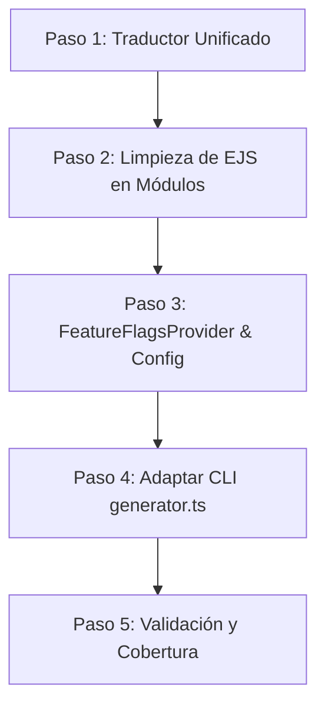

# Plan de Migracion: Feature Flags en `unbj-echo`

Este documento detalla el plan paso a paso para migrar los módulos opcionales (`tshirt`, `workshops`, `rooms`, `voting`) desde la generación condicional física (EJS) hacia un modelo híbrido controlado por **Feature Flags** (tanto en build-time como runtime).

---

## 🎯 Objetivos
1. **Eliminar la fragilidad de EJS** en la UI de los módulos opcionales. Convertir los archivos `.tsx.ejs` en archivos `.tsx` convencionales para habilitar type-checking, autocompletado y linting estático en el repositorio de plantillas.
2. **Modularidad mediante Feature Flags**: Copiar siempre todos los módulos en el proyecto generado y controlar su disponibilidad mediante configuraciones locales (`features.config.json` en build-time) y dinámicas (suscripción reactiva a Firestore en runtime).
3. **i18n Simplificado**: Crear un hook unificado `useTranslations` en el proyecto base para evitar la inyección condicional de `next-intl` vs. fallbacks en español, logrando que los componentes de los módulos no requieran plantillas EJS para el idioma.

---

## 🛠️ Plan de Trabajo Detallado

### Paso 1: Implementar Traductor Unificado (`useTranslations.ts.ejs`)
Crearemos un archivo base de traducción que funcione como puente entre `next-intl` (si está habilitado el multi-idioma) y un traductor local de fallback en español basado en `es.json` (si se elige únicamente español).

* **Archivo a crear**: [useTranslations.ts.ejs](file:///Users/raulcanul/Documents/Dev/platform-register/templates/base/apps/portal/src/hooks/useTranslations.ts.ejs)
* **Comportamiento**:
  * Si `languages === 'es-en'`, importa y devuelve el hook de `next-intl`.
  * Si `languages === 'es'`, lee directamente de `messages/es.json` y proporciona la misma firma de función.

### Paso 2: Limpiar EJS de los Módulos Opcionales y Convertir a `.tsx`
Renombraremos y limpiaremos las plantillas `.tsx.ejs` de los módulos opcionales para convertirlas en archivos de TypeScript puro (.tsx):

1. **Playera (`tshirt`)**:
   * Renombrar `ShirtSizeSelector.tsx.ejs` ➡️ `ShirtSizeSelector.tsx` en `templates/modules/tshirt/...`
   * Reemplazar la importación condicional de `next-intl` por `import { useTranslations } from '@/hooks/useTranslations'`.
2. **Talleres (`workshops`)**:
   * Renombrar `WorkshopsSelector.tsx.ejs` ➡️ `WorkshopsSelector.tsx` en `templates/modules/workshops/...`
   * Reemplazar la importación condicional por el nuevo hook unificado.
3. **Hospedaje (`rooms`)**:
   * Renombrar `RoomManager.tsx.ejs` ➡️ `RoomManager.tsx` en `templates/modules/rooms/...`
   * Reemplazar la importación condicional por el nuevo hook unificado.
4. **Votación (`voting`)**:
   * Renombrar `VoterPanel.tsx.ejs` ➡️ `VoterPanel.tsx` en `templates/modules/voting/...`
   * Reemplazar la importación condicional por el nuevo hook unificado.

### Paso 3: Configuración de Feature Flags y Contexto
Implementaremos el almacén de configuración estático (`features.config.json`) y el proveedor de contexto React para las banderas.

1. **Configuración Inicial (Build-time)**:
   * **Archivo a crear**: [features.config.ts.ejs](file:///Users/raulcanul/Documents/Dev/platform-register/templates/base/apps/portal/src/config/features.config.ts.ejs)
   * Contendrá el mapeo estático de qué módulos fueron seleccionados al generar el CLI.
2. **Proveedor React (Runtime / Firestore)**:
   * **Archivo a crear**: [FeatureFlagsContext.tsx](file:///Users/raulcanul/Documents/Dev/platform-register/templates/base/apps/portal/src/context/FeatureFlagsContext.tsx)
   * Lee la configuración local como estado inicial y se suscribe a un documento Firestore `/config/features` para sincronizar en tiempo real los toggles de UI.
3. **Actualización de la UI**:
   * **Archivo a modificar**: [ActionBlock.tsx.ejs](file:///Users/raulcanul/Documents/Dev/platform-register/templates/base/apps/portal/src/components/portal/ActionBlock.tsx.ejs)
   * Modificar para usar `useFeatureFlags()` en lugar de las directivas EJS `<% if (modules.includes('x')) %>` para los módulos opcionales.

### Paso 4: Adaptar el CLI del Generador
Modificaremos la lógica en `generator.ts` para que coincida con la nueva arquitectura:

1. **Inyección Incondicional de Módulos**:
   * `generator.ts` ahora copiará **todos** los módulos disponibles al proyecto generado.
2. **Escritura del Config JSON**:
   * Generar `features.config.json` en el directorio raíz del portal basado en los módulos que el usuario seleccionó.
3. **i18n Unificado**:
   * Actualizar `configureI18n` para que *siempre* genere `messages/es.json` (y no solo en el caso de `es-en`), para que el hook de traducción en español de un solo idioma pueda resolver las claves correspondientes.

### Paso 5: Validación y Cobertura de Pruebas
1. Compilar el generador con `npm run build`.
2. Correr la matriz de escenarios de prueba con `node scripts/test-generator.mjs`.
3. Validar que compila y que no arroja fallos de TypeScript en Next.js.
