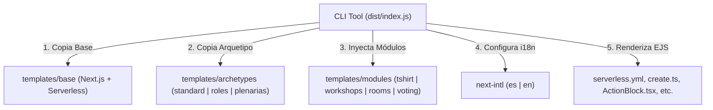

# Walkthrough y Resumen de Memoria — unbj-echo CLI

> [!NOTE]
> Este documento ha sido diseñado como un archivo de memoria persistente para el agente y los desarrolladores en sesiones posteriores.

---

## 1. Estado de la Implementación E2E

El generador de plataformas de registro (`unbj-echo`) se encuentra completamente implementado y verificado. Es capaz de estructurar un monorepo personalizado segun el arquetipo (Estandar, por Roles, o Plenarias de la CNBM) e inyectar de forma modular las funcionalidades funcionales seleccionadas.



---

## 2. Decisiones de Diseño Clave

### A. Modularización Dinámica vía EJS y Carpetas Inyectables
* Los archivos comunes pero que varían según el arquetipo se manejan mediante plantillas `.ejs` en el directorio de la plantilla base.
* Los archivos específicos de cada módulo se colocan bajo `templates/modules/{nombre_modulo}/` respetando la ruta de carpetas del monorepo base. La utilidad de copia del CLI simplemente los mezcla en el destino final.
* Los endpoints del backend asociados a un módulo se declaran en `templates/modules/{modulo}/inject-config.json`. Al ejecutarse la generación, el CLI fusiona estos endpoints dentro del archivo final `serverless.yml`.

### B. Consistencia de Datos en Entornos Serverless
* **Cupos de Talleres y Hospedaje:** Dado que AWS Lambda es efímero y stateless, se eliminaron los bloqueos pesimistas tradicionales de bases de datos relacionales. En su lugar, se implementaron **Transacciones de Firestore (`db.runTransaction`)** en los endpoints `POST /logistic/studios/select`, `POST /logistic/rooms/create`, `POST /logistic/rooms/join` y `POST /logistic/rooms/requests/respond` para garantizar la consistencia atómica y evitar race conditions o sobrecupos.
* **Votación en Tiempo Real:** En lugar de desplegar servidores WebSockets activos (Socket.io) 24/7, se aprovechó la escucha en tiempo real de Firestore en el cliente (`onSnapshot`). Cuando un administrador activa una propuesta de votación, el portal de asistentes y la pantalla del proyector capturan el cambio de estado inmediatamente y actualizan los gráficos de forma dinámica.

---

## 3. Estado de los Módulos "Puzzle Pieces"

1. **Playera (`tshirt`):**
   * **Backend:** `/users/shirt-size/status` y `/users/shirt-size/select`.
   * **Frontend:** Selector de tallas XS a 3XL ([ShirtSizeSelector.tsx](file:///Users/raulcanul/Documents/Dev/platform-register/templates/modules/tshirt/apps/portal/src/components/shirt-size/ShirtSizeSelector.tsx)).
2. **Talleres (`workshops`):**
   * **Backend:** Catálogos de talleres y asignación transaccional.
   * **Frontend:** Panel interactivo por pestañas de días en `/portal/[token]/talleres` ([WorkshopsSelector.tsx](file:///Users/raulcanul/Documents/Dev/platform-register/templates/modules/workshops/apps/portal/src/app/portal/[token]/talleres/WorkshopsSelector.tsx)).
3. **Hospedaje (`rooms`):**
   * **Backend:** Gestión completa de códigos de invitación y transferencias de liderazgo.
   * **Frontend:** Panel para crear habitaciones, solicitar ingreso y aceptar compañeros en `/portal/[token]/habitaciones` ([RoomManager.tsx](file:///Users/raulcanul/Documents/Dev/platform-register/templates/modules/rooms/apps/portal/src/app/portal/[token]/habitaciones/RoomManager.tsx)).
4. **Votación (`voting`):**
   * **Backend:** Control de propuestas (`active`, `vote`, `admin-list`, `admin-create`, `admin-toggle`).
   * **Frontend:** Votación instantánea en `/portal/[token]/votacion` ([VoterPanel.tsx](file:///Users/raulcanul/Documents/Dev/platform-register/templates/modules/voting/apps/portal/src/app/portal/[token]/votacion/VoterPanel.tsx)) y panel administrador de sondeos en vivo con modo proyector ([AdminPolls.tsx](file:///Users/raulcanul/Documents/Dev/platform-register/templates/modules/voting/apps/admin/src/app/(dashboard)/votaciones/AdminPolls.tsx)).

---

## 4. Guía de Ejecución y Pruebas

Para compilar y correr el CLI:
```bash
# Compilar CLI
npm run build

# Ejecutar el asistente de prompts interactivos
node dist/index.js
```
*Las pruebas automatizadas de scaffolding han sido validadas para los tres arquetipos, garantizando la inyección limpia de cada pieza.*
